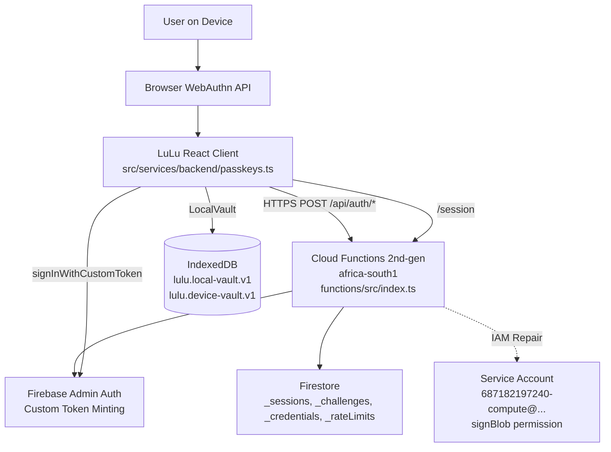

# Phase 000 — Passkey Authentication and Bounded Sessions (Retrospective) — Design

**Phase:** Phase 000 — Passkey Authentication and Bounded Sessions  
**Created:** 2026-10-25 (retrospective authoring date)  
**Revised:** 2026-10-25  
**Status:** RETROSPECTIVE DRAFT  
**Requirements Approved:** UNAPPROVED — Retrospective reconstruction only  
**Approved:** UNAPPROVED — NO EXECUTION AUTHORITY  
**Depends On:** None (foundational capability implemented before formal SDD)  
**Precedes:** Phase 001 Architecture Foundation (draft, unapproved)  
**Strategy doc:** [Product Vision](../../../../memory/product-vision.md) — Section 4 "Private mappings and protected access", Section 5 "Continuity and recovery as product experiences"  
**Authoring Exception:** All three artifacts drafted together for this bounded retrospective evaluation only, per owner authorization. This does not establish a precedent for forward phases.

---

## Design Overview

This document details the **as-implemented** architecture for LuLu's passkey-only authentication and bounded private-session system, reverse-engineered from the working codebase as of 2026-10-25. It specifies exact technology choices, contracts, state machines, file ownership, and cross-component boundaries. No speculative or forward-looking design is included; every decision corresponds to shipped (or locally verified) code.

**Authoring exception:** On 2026-10-25 the owner authorized requirements, design, and tasks co-authoring for this single retrospective spec with no interim document-creation stops. This design is complete for review but is not implementation approval. Tasks, start, and deployment gates remain separate. Formal SDD progression remains paused per `.sdd/memory/governance/2026-10-24-hackathon-sdd-pause.md`.

---

## 1. Delivery Sequence (As Implemented)

1. Firebase project `khora-lulu-2026` provisioned (Blaze, africa-south1, 2nd-gen Functions).
2. Cloud Functions deployed: `api` (HTTPS, CORS-restricted, 256MiB, maxInstances=2, concurrency=10).
3. Firestore collections created: `_sessions`, `_challenges`, `_credentials`, `_rateLimits`.
4. WebAuthn server-side: `@simplewebauthn/server` for option generation and response verification.
5. Client WebAuthn: `@simplewebauthn/browser` for registration/authentication ceremonies.
6. Firebase Auth: `inMemoryPersistence` + custom tokens with `{sid, passkey: true}` claims.
7. Client session model: `AppSession {uid, expiresAt, privateUntil}` from `/session`.
8. Private step-up: `/auth/stepup/options` → WebAuthn → `/auth/stepup/verify` → `privateUntil = now + 10min`.
9. Client guards: auto-expiry timers, quick-exit, Escape, visibility-change → `handleExitProtected()`.
10. Local vault: `LocalVault` bound to `ownerId` + `generation()` + `isUnlocked()` callbacks.
11. IAM repair: `roles/iam.serviceAccountTokenCreator` granted to runtime SA (2026-10-25).
12. Live auth test: synthetic account registered, signed in, step-up verified, cleaned up (evidence recorded).

---

## 2. Architecture and Boundaries



**Boundary Rules:**
- Client never computes session validity; `/session` is the sole authority.
- Private access (`privateUntil > now`) is a server-authored field; client mirrors it via `privateAuthority` ref.
- LocalVault is a **storage boundary, not authentication** (per `localVault.ts` JSDoc). It trusts `LocalVaultSession` callbacks for authorization.
- Credential IDs are SHA-256 hashed before Firestore storage; raw credential IDs never leave server memory.
- Origin allowlist enforced at Functions entry point; CORS headers echo request origin.
- No request body, tokens, messages, or stacks logged — only bounded diagnostics (`route`, `stage`, `code`, `name`, `cleanupFailed`).
- Rate limiting per IP (60/15min) applies only to `/auth/*` routes.

### Current Integration Seams

| Seam | Client Path | Server Path | Contract |
|------|-------------|-------------|----------|
| Registration options | `passkeys.ts:28` → `/auth/register/options` | `index.ts:85-92` | `{options, challengeId}` |
| Registration verify | `passkeys.ts:30` → `/auth/register/verify` | `index.ts:94-120` | `{customToken, expiresAt}` |
| Sign-in options | `passkeys.ts:28` → `/auth/login/options` | `index.ts:122-129` | `{options, challengeId}` |
| Sign-in verify | `passkeys.ts:30` → `/auth/login/verify` | `index.ts:131-159` | `{customToken, expiresAt}` |
| Step-up options | `passkeys.ts:34-35` → `/auth/stepup/options` | `index.ts:122-129` | `{options, challengeId}` |
| Step-up verify | `passkeys.ts:36-38` → `/auth/stepup/verify` | `index.ts:151-157` | `{privateUntil}` |
| Session fetch | `passkeys.ts:32` → `/session` | `index.ts:162-163` | `AppSession` |
| Lock private | `passkeys.ts:44` → `/auth/lock` | `index.ts:164` | `{success: true}` |
| Logout | `passkeys.ts:40-43` → `/auth/logout` | `index.ts:165` | `{success: true}` |

Paths relative to repository root. Frontend is a single React/Vite app (not a submodule).

---

## 3. Information Architecture

| Destination | Primary View | Detail/Handoff | Route Treatment |
|-------------|--------------|----------------|-----------------|
| `/` (welcome) | OnboardingAuth welcome screen | orientation → create/signin | Preserved |
| `/` (signed in) | JournalHome | compose, leaves, reader, vault, inspector | Preserved |
| Protected gate | ProtectedGateModal (dialog) | step-up → vault/inspector | Modal, not route |
| Private writing | LocalPrivateJournal (local-private view) | compose, exit | View, not route |
| Sign-out | Avatar menu → signOutAccount | clears all state, logs out | Action, not route |

No legacy routes to preserve; this is the first auth implementation.

---

## 4. Shared Contracts

### 4.1 Server Session Document (`_sessions/{sid}`)

```typescript
interface SessionDoc {
  uid: string;
  expiresAt: number;           // Date.now() + SESSION_TTL (12h)
  privateUntil: number;        // 0 or Date.now() + PRIVATE_TTL (10min)
  purgeAfter: Timestamp;       // = expiresAt (Firestore TTL)
}
```

### 4.2 Client AppSession (from `/session`)

```typescript
type AppSession = { uid: string; expiresAt: number; privateUntil: number };
```

### 4.3 Challenge Document (`_challenges/{challengeId}`)

```typescript
interface ChallengeDoc {
  challenge: string;           // base64url from simplewebauthn
  kind: 'register' | 'login' | 'stepup';
  uid: string | null;          // registration: generated uid; login/stepup: from session
  sid: string | null;          // stepup: from session; else null
  origin: string;              // request origin
  rpID: string;                // request origin hostname
  expiresAt: number;           // Date.now() + CHALLENGE_TTL (5min)
  used: boolean;               // set true by takeChallenge
  purgeAfter: Timestamp;       // = expiresAt
}
```

### 4.4 Credential Document (`_credentials/{hash(credentialId)}`)

```typescript
interface CredentialDoc {
  uid: string;
  id: string;                  // raw credential ID (not hashed here)
  publicKey: string;           // base64
  counter: number;             // updated on each authentication
  transports: string[];        // AuthenticatorTransportFuture[]
  createdAt: Timestamp;
  lastUsedAt: Timestamp;       // updated on each authentication
}
```

### 4.5 LocalVaultSession (Client Callback Interface)

```typescript
interface LocalVaultSession {
  ownerId: string;             // Firebase Auth uid
  generation: () => number;    // monotonic; incremented on lock/exit/account-change
  isUnlocked: () => boolean;   // reflects current authorization (not snapshot)
}
```

### 4.6 LocalVault Revision (Decrypted)

```typescript
interface LocalVaultRevision {
  ownerId: string;
  recordId: string;
  revisionId: string;
  parentRevisionId: string | null;
  kind: 'original' | 'derived';
  provenance: 'user-authored' | 'user-captured' | null;
  clientCreatedAt: string;     // ISO string, device clock only
  content: unknown;            // plain JSON, ≤1MB, synthetic markers rejected
  sha256: string;              // content hash for integrity
}
```

### 4.7 Device Vault Envelope (Encrypted Payload)

```typescript
interface Envelope {
  version: 1;
  iv: string;                  // base64, 12 bytes
  ciphertext: string;          // base64
}
```

---

## 5. Interaction State Machines

### 5.1 Server Session Lifecycle

```text
[Registration Options] → [Registration Verify] → [Session Created: privateUntil=0]
       ↓                        ↓
  (challenge)             (credential + user)
       ↓                        ↓
[Login Options] → [Login Verify] → [Session Created: privateUntil=0]
       ↓                        ↓
  (challenge)             (credential check)
       ↓                        ↓
[Step-up Options] → [Step-up Verify] → [Session Updated: privateUntil=now+10min]
       ↓                        ↓
  (challenge)             (credential check + sid match)
       ↓                        ↓
[/auth/lock] → [privateUntil=0]          [/auth/logout] → [Session Deleted]
       ↓                                                      ↓
[Session Expired] → [Auto-purge via TTL]                     [Client signs out]
```

### 5.2 Client Private Authority State Machine

```text
PRIVATE_INACTIVE (privateUntil=0, generation=G, localVault=null)
    │
    ├─ unlockPrivate() → step-up success → PRIVATE_ACTIVE
    │
    └─ (no other transitions)

PRIVATE_ACTIVE (privateUntil=T, generation=G, localVault=V)
    │
    ├─ privateUntil reached (timer) → handleExitProtected() → PRIVATE_INACTIVE (generation=G+1)
    ├─ Quick Exit button → handleExitProtected() → PRIVATE_INACTIVE (generation=G+1)
    ├─ Escape key → handleExitProtected() → PRIVATE_INACTIVE (generation=G+1)
    ├─ visibilitychange (hidden) → handleExitProtected() → PRIVATE_INACTIVE (generation=G+1)
    ├─ lockPrivate() → PRIVATE_INACTIVE (generation=G+1, server privateUntil=0)
    ├─ signOutAccount() → PRIVATE_INACTIVE (generation=G+1, session deleted)
    └─ session expires → signOutAccount() → PRIVATE_INACTIVE (generation=G+1)
```

### 5.3 LocalVault Operation Guard

Every public method (`createOriginal`, `appendDerived`, `getRevision`, `getLatest`, `listRevisions`, `listRecords`):

```text
[Method Entry] → assertSession(session, ownerId, generation)
    │
    ├─ PASS → [Async Operation] → assertSession(...) after each await
    │              │
    │              └─ FAIL → throw LocalVaultLockedError
    │
    └─ FAIL → throw LocalVaultLockedError
```

`assertSession` validates: `isUnlocked() === true`, `session.ownerId === ownerId`, `session.generation() === generation`, `generation` is safe integer.

---

## 6. File Change Map (As Implemented)

| Area | Paths | Responsibility |
|------|-------|----------------|
| Server API entry | `functions/src/index.ts` | HTTPS handler, routing, CORS, origin allowlist, rate limit, challenge/session/credential ops |
| Server policy | `functions/src/policy.ts` | TTL constants, types, `assertChallenge`, `assertSession`, `mintBeforePersist`, `withCompensation`, `failureDiagnostic`, `ApiError` |
| Client passkey orchestration | `src/services/backend/passkeys.ts` | `authenticate`, `unlockPrivate`, `lockPrivate`, `logout`, `request`, `AppSession`, `BackendRequestError`, `authError` |
| Client Firebase config | `src/services/backend/firebase.ts` | `initializeApp`, `auth` (inMemoryPersistence), `authReady`, `database` |
| Client session state | `src/App.tsx` (JournalApp) | `privateAuthority`, `localVault`, `privateUntil`, `protectedMode`, `privateUnlockAttempt`, `originalReadRequest`, timers, `handleExitProtected`, `handleProtectedSuccess` |
| Onboarding UI | `src/components/OnboardingAuth.tsx` | Welcome/orientation/create/signin screens, passkey support detection, failure reason mapping, `AuthActionResult` |
| Protected gate UI | `src/components/ProtectedGateModal.tsx` | `<dialog>` modal, step-up trigger, busy/error states, ARIA |
| Auth boundary | `src/components/auth/AuthBoundary.tsx` | Hosts `OnboardingAuth`, calls `authenticate`, manages `session` state, blocks `127.0.0.1` |
| Local vault core | `src/services/vault/localVault.ts` | `LocalVault` class, IndexedDB schema, encryption via `deviceVault`, revision chain validation |
| Device vault crypto | `src/services/backend/deviceVault.ts` | `encryptPrivate`, `decryptPrivate`, `keyFor` (IndexedDB AES-GCM key per uid) |
| Private capture | `src/services/privateCapture.ts` | `capturePrivateText` → `LocalVault.createOriginal` |
| Journal storage | `src/services/backend/journal.ts` | `watchEntries`, `saveEntry`, `readOriginal`, `updateEntry` (Firestore) |
| Protected writing view | `src/components/ProtectedWritingView.tsx` | Masked/unmasked prose, enclave toast, entity inspector entry |
| Private sanctuary | `src/components/PrivateSanctuaryView.tsx` | Vault tab content, quick exit, trusted contacts, calm focus |
| Entity inspector | `src/components/EntityInspectorView.tsx` | Entity list, alias editing, session-scoped updates |

---

## 7. Requirement Traceability and Verification

| Requirement | Design Sections | Implementation Files | Verification Evidence |
|-------------|-----------------|----------------------|----------------------|
| REQ-000.1 | §2, §4.1, §4.2, §5.1 | `passkeys.ts`, `index.ts:85-120`, `OnboardingAuth.tsx`, `AuthBoundary.tsx` | Live auth test (2026-10-25): registration, sign-in, custom token, session fetch |
| REQ-000.2 | §4.1, §4.3, §5.1 | `index.ts:13-32, 43-61`, `policy.ts:1-3, 53-62` | Session TTL 12h, private TTL 10min, challenge TTL 5min in code; Firestore TTL on `purgeAfter` |
| REQ-000.3 | §4.2, §4.5, §5.2, §5.3 | `App.tsx:45-82, 83-95, 136-168`, `passkeys.ts:24-39`, `localVault.ts:130-144` | Auto-expiry timers (lines 66, 71), `handleExitProtected` (lines 159-168), generation scoping |
| REQ-000.4 | §4.4, §5.2 | `OnboardingAuth.tsx`, `ProtectedGateModal.tsx`, `AuthBoundary.tsx` | Screen flow, failure copy, `local-origin` link, `recoveryAction`, ARIA roles |
| REQ-000.5 | §4.5, §4.6, §5.3 | `localVault.ts:26-33, 130-144, 366-379`, `deviceVault.ts:19-37`, `App.tsx:141-146` | `LocalVaultSession` callbacks, `assertSession` at every operation, generation increment on exit |
| REQ-000.6 | §2, §4.1, §4.3, §5.1 | `index.ts:13-14, 33-42, 43-52, 145-150, 167-175`, `policy.ts:8-16, 42-51` | Origin allowlist, rate limit, challenge consumption, counter check, bounded logging, IAM repair evidence |

---

## 8. Risks, Mitigations, and Handoff

- **Local vault key not passkey-bound:** Key generated/stored in IndexedDB per `uid`; browser data loss = key loss. No cross-device recovery. *Mitigation:* Documented in `localVault.ts:11-12` and `deviceVault.ts:1-2`. Future phase must address via passkey-derived key or secure sync.
- **No multi-device credential sync:** Each device registers independently; no credential export/import. *Mitigation:* Acceptable for hackathon demo; future phase needs WebAuthn `credentialId` sync or passkey provider (iCloud/Google Password Manager) reliance.
- **Private session TTL hardcoded (10 min):** `PRIVATE_TTL = 10 * 60_000` in `policy.ts`. *Mitigation:* Configurable via env var in future; current value matches UX copy ("up to ten minutes").
- **IAM `signBlob` permission manual repair required:** Runtime SA lacked `roles/iam.serviceAccountTokenCreator`. *Mitigation:* Documented in governance; guardrails added to prevent drift (`scripts/firebase-guard.mjs`).
- **Synthetic account test cleanup manual:** 2026-10-25 test created/cleaned up manually; no automated test harness. *Mitigation:* Evidence recorded in `.sdd/evidence/passkey-auth-fix/`.
- **Physical-device acceptance pending:** Owner confirmed native sign-in works post-repair; full private-flow device acceptance open. *Mitigation:* Tracked in active-context and project snapshot.
- **New diagnostic/recovery server changes unpublished:** Local fixes for passkey failure diagnosis not deployed. *Mitigation:* Evidence in `.sdd/reports/passkey-auth-fix/2026-10-25-diagnosis.md`; deployment requires owner authorization.

**Handoff to Phase 001/004+:** Stable contracts: `AppSession`, `/session`, `unlockPrivate()`, `lockPrivate()`, `LocalVaultSession`, `LocalVault` API. Next phases consume these; do not modify auth/session boundary without traceability update.

---

## Approval Gate

**RETROSPECTIVE DRAFT — UNAPPROVED — NO EXECUTION AUTHORITY**

This document reconstructs design from the as-implemented system as of 2026-10-25. It does not authorize any code changes, tests, builds, deployment, merge, archive, or hook behavior. Formal SDD progression remains paused. Phase 001 Architecture Foundation remains an unapproved draft. This retrospective spec is for documentation and traceability only. Owner review required before any formal approval.