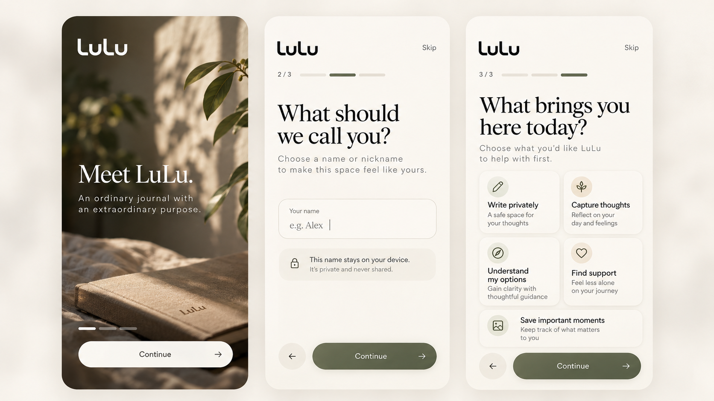

<p align="center">
  <picture>
    <source media="(prefers-color-scheme: dark)" srcset="public/media/brand/lulu-wordmark-white.png">
    
  </picture>
</p>

<h1 align="center">Your story. Your safety. Your choice.</h1>
<p align="center"><strong>A journal and storybook for everyday writing and protected personal documentation.</strong></p>
<p align="center">
  <a href="https://lulu.thisisphila.co.za/"><strong>Try the live web demo</strong></a>
  &nbsp;·&nbsp;
  <a href="https://github.com/ThisIsPhila/LuLu/releases/tag/android-ios-preview-2026-10-27">Download mobile previews</a>
  &nbsp;·&nbsp;
  <a href="#experience-lulu">Explore the experience</a>
  &nbsp;·&nbsp;
  <a href="#availability-and-platforms">Platforms</a>
  &nbsp;·&nbsp;
  <a href="#behind-the-project">Project library</a>
</p>

---

## Meet LuLu



Sometimes the first step is simply writing something down.

LuLu is a **journal and storybook for everyday writing and protected personal documentation**. You can capture a thought, save an important moment and return to an ordinary journal. When something needs greater privacy, LuLu's protected-writing experience is designed to help preserve it without requiring you to decide immediately whether to disclose it or seek help.

The wider vision connects **capture → preservation → understanding → choice → support**: one continuous experience for people who may not yet know what to call what they're experiencing, what their options are, or when they will feel ready to act.

Created by **Team KHÔRA** for the **FNB App of the Year Hackathon 2026**, addressing the challenge **Safer communities and gender-based violence (GBV) response**.

> **Our principle:** The person owns their story. Original records should remain theirs; interpretation, sharing and seeking support should happen on their terms.

## Experience LuLu

### For the demo, start with the live web app

**[Open the live LuLu web app](https://lulu.thisisphila.co.za/)**

This is the recommended way for judges and reviewers to try LuLu. It opens in a browser and does not require installing a native app. Create your own account using a passkey, email or Google sign-in; there is no shared demo password.

| Step | What to do | What you'll see |
| --- | --- | --- |
| **1. Create your space** | Create an account or sign in. | Your own journal space, with a passkey prompt if you choose passkey sign-in. |
| **2. Explore the journal** | Open ordinary journal entries, edit one and save. | Fictional starter entries are added to new accounts; they can be edited. |
| **3. Explore Stories** | Navigate to **Stories** in the ordinary experience. | A familiar, everyday writing surface. |
| **4. Explore protected writing** | Select **Private** or **Write privately**. | Protected access is separate from signing in and uses a passkey check. |

Lu can guide people around the app, answer LuLu-related questions and help with ordinary journal or story writing. AI tools require the private judge invitation unless the account is the owner account.

**Cloud demo:** Open **Settings → Privacy processing → Cloud processing demo** to compare original text with the PII replacements and review an advisory Decisions result. In a journal or story draft, two line breaks move a finished paragraph into the same review workspace. The original goes to LuLu's cloud privacy service; only the scrubbed version is available to Lu. Voice is a separate cloud feature and sends audio directly to GPT-Live after the user starts it.

### The experience we're building

| | The interaction | Why it matters |
| --- | --- | --- |
| **Everyday writing** | Write, edit and organise journal entries and stories. | LuLu is useful as an ordinary writing app, not just as an emergency tool. |
| **Private writing** | Enter a separate protected space for sensitive records. | A person can document something without committing to report it. |
| **Capture and preserve** | Keep text and supporting image/audio material with an entry. | Their original account and supporting information can be preserved. |
| **Conceal and return** | Use privacy controls and quick exit where implemented. | Private material is not left visibly open during ordinary use. |
| **Understand options** | Review scrubbed text for advisory behavior signals with Decisions. | This is not a diagnosis, a verdict, or a prediction of future events. |
| **Choose support** | Browse a source-linked support directory. | LuLu does not yet send referrals or share records with professionals. |

## What works today

Rather than treating a design concept, a local implementation and a deployed release as equivalent, we track each separately.

| Capability | Live hosted web app | Current repository source |
| --- | --- | --- |
| Passkey, Google and email sign-in | Available; account acceptance depends on the chosen provider | Available |
| Journal and story writing | Available | Available |
| Cloud PII review | Deployed; signed-in end-to-end acceptance is still pending | Original text is reviewed in the cloud; source highlights and generic replacements are shown |
| Decisions pattern review | Deployed; a synthetic request to `gpt-6-luna` returned successfully; app-level acceptance is pending | Advisory behavior signals from reviewed, scrubbed text |
| Lu text chat and app actions | Deployed; signed-in conversation acceptance is pending | `gpt-6-luna` with bounded search, navigation, entry opening and draft tools |
| Lu live voice | Deployed; a real voice conversation has not yet been verified | GPT-Live receives audio directly for the cloud demo and can use Lu's app tools |
| Judge access and account controls | Deployed; verify through the owner account | Shared invitation, per-account access, request counts and configurable limits |
| New-account alerts | In-app and email alerts go to `lulu@thisisphila.co.za` | Email delivery uses Resend; there is no cost or billing digest yet |
| Lu reply languages | English, Afrikaans and isiZulu | These choices affect Lu's replies; the whole app is not translated |
| On-device AI | On hold; not used by the cloud demo | Experimental local model remains separate and is not the active processing path |
| Future-event prediction and professional referrals | Not available | No future-event prediction or referral system is implemented |

**Privacy implementation note.** In the newer source, private originals and media are encrypted using AES-GCM in browser IndexedDB. The vault's key resides in browser storage and is **not cryptographically bound to the passkey**. Clearing browser data may destroy access unless an appropriate backup exists. Full offline unlock, cross-device recovery and native-device security acceptance are not yet established. Older cloud-backed protected records use a separate legacy read path.

For detailed engineering notes, see the [implementation tracker](docs/product/2026-10-25-task-status.md) and [mobile report](docs/implementation/2026-10-26-capacitor-mobile.md).

## Availability and platforms

| Platform | How to access | Status |
| --- | --- | --- |
| **Web** | **[Open the live demo](https://lulu.thisisphila.co.za/)** | Recommended for demos and reviews; hosted release available. |
| **PWA install** | Not available yet; use the regular web link above. | LuLu does not currently provide a web manifest/install prompt. Offline account access and private-vault recovery are not guaranteed. |
| **Android** | [Download the development APK](https://github.com/ThisIsPhila/LuLu/releases/download/android-ios-preview-2026-10-27/LuLu-Android-preview.apk). | Debug-signed preview for Android 7.0 or later; not a Play Store release. |
| **iOS** | Build from source or obtain the registered-device build privately from the project owner. | The development build is limited to the registered iPhone and installed from a Mac with Xcode. No TestFlight or App Store download is available. |

### Download and install a mobile preview

- **Android:** [Download the preview APK](https://github.com/ThisIsPhila/LuLu/releases/download/android-ios-preview-2026-10-27/LuLu-Android-preview.apk). This is a debug-signed test build, not the latest source or a Play Store release.
- **iPhone:** The current development app is installed privately from a Mac onto the registered iPhone. There is no public IPA, TestFlight or App Store link.

See the [mobile installation guide](docs/mobile-installation.md) for the detailed steps. On-device AI is on hold and is not part of the live cloud demo.

### Build a mobile version from source

These steps are for developers with the platform toolchain. For a demo, use the **live web app** above.

```bash
npm install
npm run native:sync
```

- **Android:** install Android Studio, the Android SDK and JDK 21, connect a physical Android device with developer debugging enabled, then run `npm run native:open:android`. Select the device in Android Studio and run the `app` configuration. A separate release signing key is required for a production APK/AAB.
- **iOS:** on macOS, install Xcode, connect an iPhone, then run `npm run native:open:ios`. Select a signing team and the connected device in Xcode, then run the app. Apple signing is required before distributing an IPA or TestFlight build.

The downloadable builds above are development previews. No Play Store, TestFlight or App Store release has been published.

## Behind the project

LuLu's repository includes an **interactive HTML documentation library** showing how the product was researched, designed and developed. It is useful for judges who want to inspect more than the final interface.

Explore **Documents** for the business canvas, SSDLC/security assessment, onboarding flow and screen plan; **Media** for the brand kit, logos and design boards; and **Tasks** for production progress and dated reports.

**[Open the project library HTML](docs/hackathon/review.html)** · **[Design resources](docs/design/README.md)**

For the full interactive reader, run `npm run dev` and visit **[localhost:5173/docs/hackathon/review.html#canvas](http://127.0.0.1:5173/docs/hackathon/review.html#canvas)**. The browser-based reader is a **local project workspace**, not a separate public deployment. The screenshots and design boards illustrate design intent; they should not be interpreted as proof that every illustrated feature is in the live build.

## How it's built

LuLu uses **React, TypeScript and Vite**, Firebase Authentication and Firestore, and a **Firebase Cloud Functions** API in Johannesburg. Server-only OpenAI and Resend secrets power cloud PII review, Decisions, Lu text and live voice, and account alerts. The phone builds use **Capacitor 8**; on-device AI remains separate and is on hold.

Lu keeps ordinary journal entries separate from protected writing. Lu can help with LuLu, search ordinary entries when asked, and open a draft for review. It does not browse protected writing or save a draft without the user's action.

## Run from source

Requirements: Node.js and npm, plus configured development environment credentials for the relevant Firebase functionality.

```bash
npm install
npm run dev
```

| Address | Purpose |
| --- | --- |
| `http://127.0.0.1:5173/` | Current responsive application |
| `http://127.0.0.1:5173/demo/` | Interactive local frame for the main application |
| `http://127.0.0.1:5173/demo/legacy.html` | Independent historical prototype, not the current app |
| `http://127.0.0.1:5173/docs/hackathon/review.html#canvas` | Interactive project documentation library |

### Builds and checks

```bash
npm run build          # type-check and build app/demo outputs
npm test               # run project tests
npm run build:hosted   # prepare hosted app output; does not deploy
npm run native:sync    # build and sync Capacitor platforms
npm run native:android # Android native build workflow
npm run native:ios     # iOS native build workflow
```

Native workflows require their platform toolchains. The mobile status is documented in the [mobile report](docs/implementation/2026-10-26-capacitor-mobile.md).

---

<p align="center"><strong>LuLu · Team KHÔRA</strong><br>FNB App of the Year Hackathon 2026 · Safer communities and GBV response</p>
<p align="center"><em>Your story. Your safety. Your choice.</em></p>
